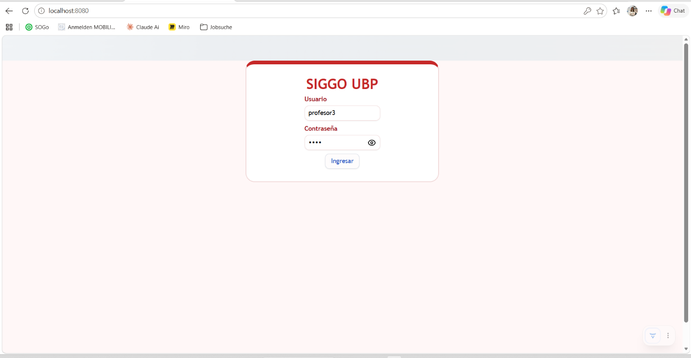
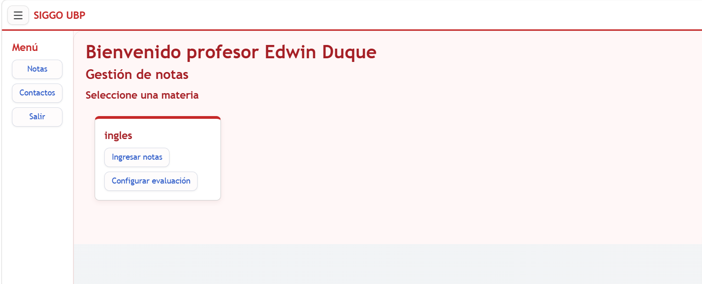
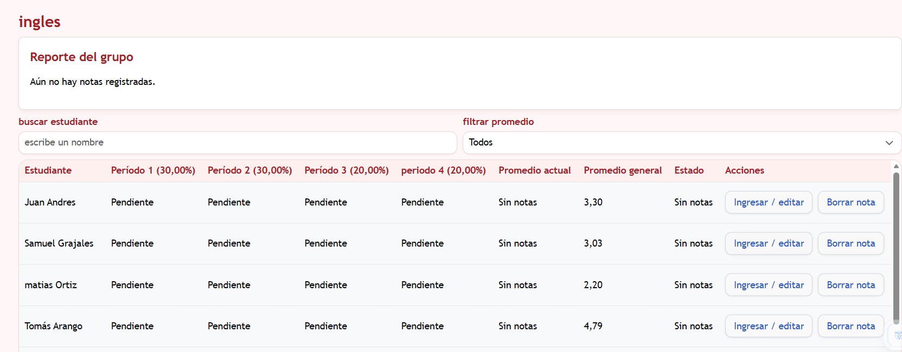
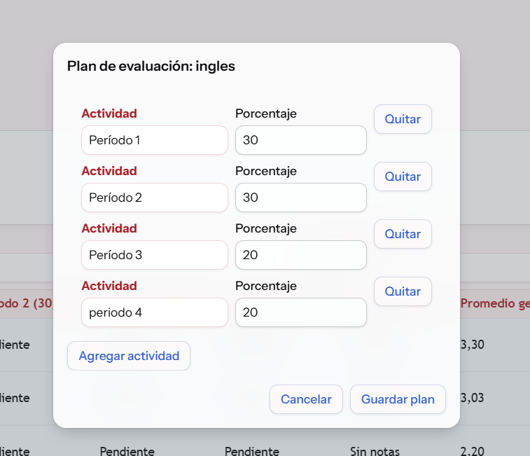
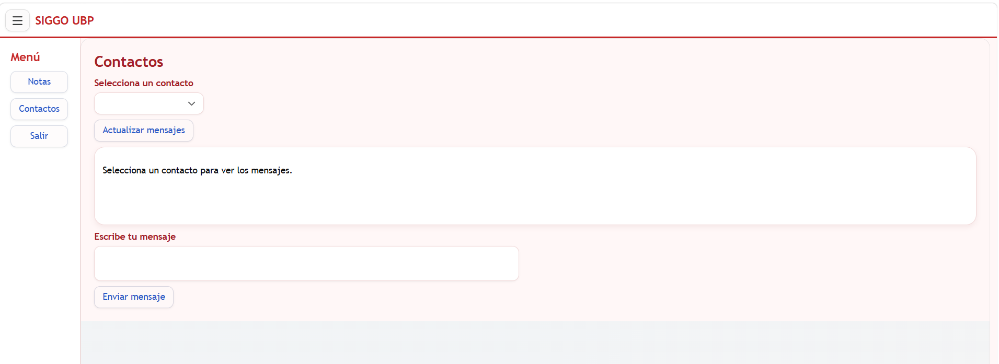
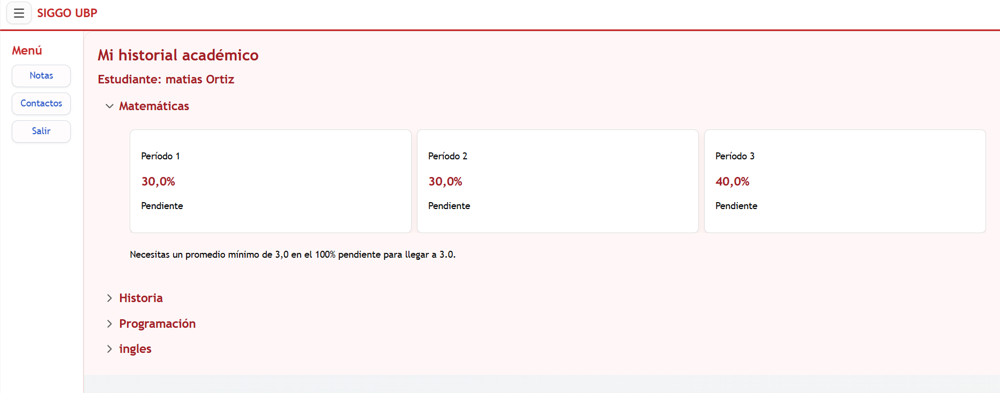

# SIGGO UBP — Gestión de notas académicas

Aplicación web para que docentes gestionen las calificaciones de sus asignaturas y estudiantes consulten su historial académico. Está desarrollada con Java, Spring Boot y Vaadin, y almacena la información en archivos de texto.

## Funcionalidades

### Profesor

- Consulta las asignaturas asignadas a su cuenta y los estudiantes inscritos.
- Busca estudiantes por nombre y filtra por estado del promedio.
- Registra, edita y elimina notas mediante diálogos; antes de borrar, solicita confirmación.
- Muestra las notas por actividad, el promedio actual y general, y resalta a quienes tienen promedio menor a 3.0.
- Presenta el promedio del grupo, la nota más alta y más baja, y el porcentaje de aprobación.
- Configura las actividades evaluativas y sus porcentajes por asignatura.

### Estudiante

- Consulta el historial académico agrupado por asignatura.
- Revisa el nombre, porcentaje y nota de cada actividad.
- Ve la nota mínima que necesita para llegar a 3.0, o si ya ganó o ya no le alcanza.

### Contactos

Permite que estudiantes y profesores seleccionen un contacto del otro rol, consulten la conversación y envíen mensajes.

## Plan de evaluación configurable

Cada asignatura puede tener sus propias actividades y porcentajes. El plan solo se guarda cuando los porcentajes suman 100%. Si no existe un plan personalizado, se usa el plan inicial:

| Actividad | Porcentaje |
|---|---:|
| Período 1 | 30% |
| Período 2 | 30% |
| Período 3 | 40% |

El Grid genera columnas según el plan. Las notas se relacionan con el número y orden de la actividad, así que el sistema evita quitar actividades que tengan notas guardadas fuera del nuevo rango. Las calificaciones aceptan valores de 0.0 a 5.0 con máximo un decimal. El estudiante ve una proyección basada en sus puntos ponderados y el porcentaje pendiente.

## Tecnologías y requisitos

- Java 21 (JDK 21)
- Spring Boot 4.1.2
- Vaadin 25.3.4
- Maven Wrapper
- Archivos de texto para persistencia

Se requiere conexión a Internet la primera vez para descargar dependencias Maven.

## Ejecutar la aplicación

En PowerShell, desde la raíz del repositorio:

```powershell
cd .\notascurso
.\mvnw.cmd spring-boot:run
```

Abre [http://localhost:8080](http://localhost:8080). Para detener la aplicación, vuelve a la terminal y presiona `Ctrl+C`.

## Ejecutar las pruebas

Desde la carpeta `notascurso`:

```powershell
.\mvnw.cmd clean test
```

Las pruebas cubren cálculos y almacenamiento de notas, configuración y validación de planes, y lectura y validación de usuarios.

## Cuentas de demostración

Las cuentas de ejemplo están en `notascurso/src/main/resources/usuarios.txt`.

| Rol | Usuario | Contraseña |
|---|---|---|
| Profesor | `profesor1` | `1234` |
| Estudiante | `estudiante1` | `1234` |

Son credenciales locales de demostración. Las contraseñas se guardan en texto plano para este ejercicio; no uses credenciales reales.

## Archivos de datos

### `usuarios.txt`

Ubicado en `notascurso/src/main/resources/usuarios.txt`. Cada línea contiene cinco campos separados por `|`:

```text
usuario|contraseña|nombre|rol|asignatura1,asignatura2
```

Las asignaturas se separan por comas. Se reconocen los roles `PROFESOR`, `ESTUDIANTE` y sus variantes con prefijo `ROLE_`.

### `notas.txt`

Se guarda en la carpeta del proyecto al ejecutar desde `notascurso`. Formato:

```text
usuarioEstudiante|asignatura|numeroActividad|nota
```

### `planes.txt`

Se guarda junto a `notas.txt` cuando se registra un plan personalizado. Formato:

```text
asignatura|nombreActividad|porcentaje
```

Si una asignatura no tiene un plan guardado, se usa el plan predeterminado 30/30/40.

### `mensajes.txt`

Guarda mensajes en formato `emisor|receptor|mensaje` y se crea al enviar el primer mensaje. Su ruta depende del directorio desde donde se ejecuta la aplicación.

## Estructura principal

- `MainView.java`: inicio de sesión y navegación según el rol.
- `DashboardLayout.java`: menú compartido con `AppLayout`.
- `ProfesorView.java`: notas, reportes y configuración del plan.
- `EstudianteView.java`: historial y proyección académica.
- `ContactosView.java`: conversaciones entre profesores y estudiantes.
- `cuentaUsuario.java`: datos de cuenta y asignaturas.
- `Estudiante.java`: modelo de estudiante.
- `Asignatura.java`: modelo de asignatura y actividades.
- `ActividadEvaluativa.java`: nombre y porcentaje de una actividad.
- `Nota.java`: calificación de una actividad.
- `servicio.java`: lectura de usuarios, autenticación y sesión.
- `NotasService.java`: persistencia, validaciones y cálculos de notas y planes.

## Capturas de pantalla

### Inicio de sesión



### Asignaturas del profesor



### Reporte y notas del grupo



### Plan de evaluación



### Contactos



### Historial del estudiante



## Diseño y alcance

Los estilos de la aplicación están en `notascurso/src/main/resources/META-INF/resources/css/siggo.css`. La interfaz incluye ajustes para pantallas pequeñas; se recomienda validar las vistas en un navegador móvil antes de la entrega.

El CRUD implementado es el de las notas. Los usuarios y asignaturas de demostración se configuran en `usuarios.txt`; no hay una pantalla CRUD independiente para administrarlos.

## Entrega

Publica el proyecto en un repositorio público de GitHub y entrega el enlace según las instrucciones del curso. No publiques datos personales ni credenciales reales.
