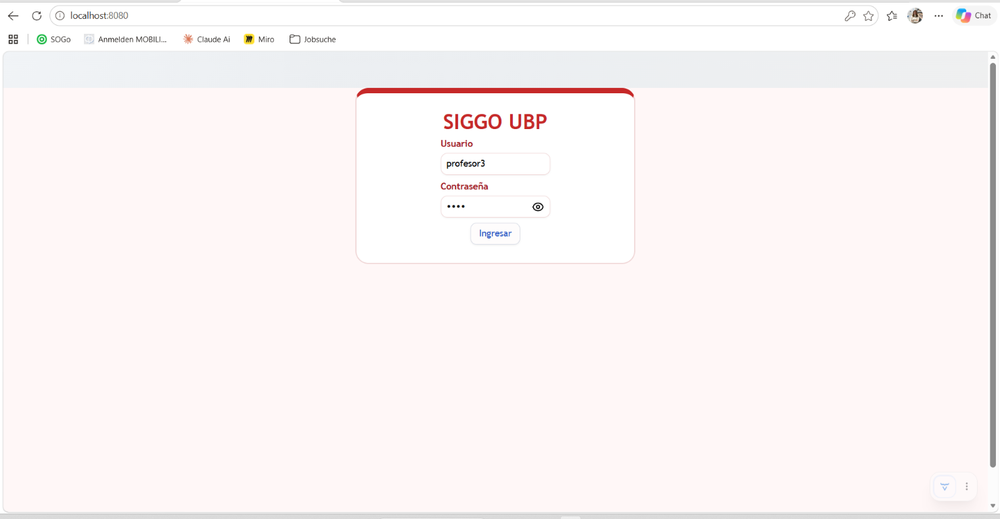
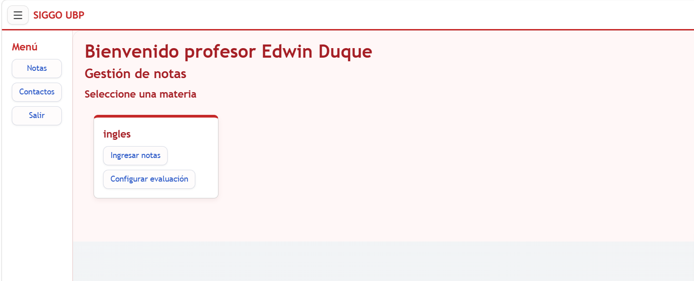
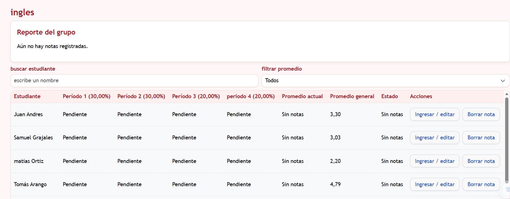
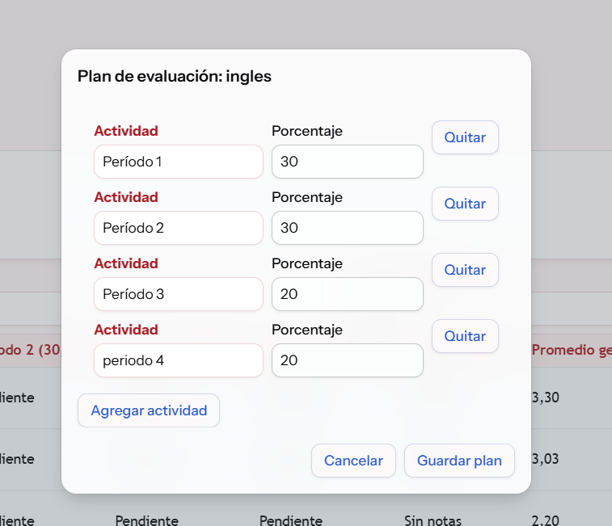
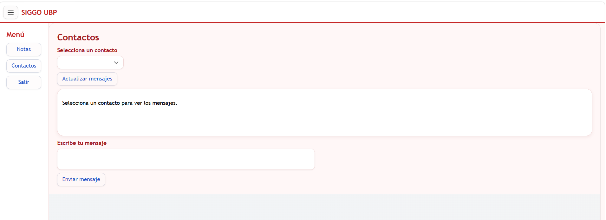
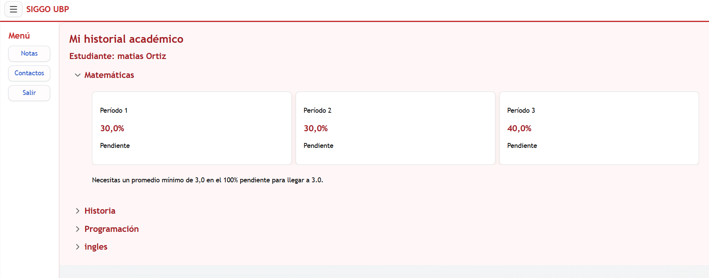

# SIGGO UBP — Gestión de notas académicas

Aplicación web para que docentes gestionen las calificaciones de sus asignaturas y estudiantes consulten su historial académico. El proyecto está desarrollado con Java, Spring Boot y Vaadin, y guarda la información en archivos de texto.

## Funcionalidades

### Vista del profesor

- Consulta las asignaturas asignadas a su cuenta.
- Busca estudiantes por nombre y filtra por estado del promedio.
- Registra, edita y elimina notas mediante diálogos.
- Confirma antes de eliminar una nota.
- Muestra las notas por actividad, el promedio actual de la asignatura, el promedio general y el estado del estudiante.
- Resalta a quienes tienen promedio menor a 3.0.
- Presenta el promedio del grupo, la nota más alta y la más baja, y el porcentaje de aprobación.
- Permite configurar las actividades evaluativas de cada asignatura.

### Vista del estudiante

- Consulta su historial agrupado por asignatura.
- Revisa el nombre, porcentaje y nota de cada actividad.
- Ve la nota mínima necesaria para alcanzar 3.0, o un aviso si ya ganó o si ya no le alcanza.

### Contactos

Estudiantes y profesores pueden seleccionar un contacto del otro rol, consultar la conversación y enviar mensajes.

## Plan de evaluación configurable

Cada asignatura puede tener actividades con nombres y porcentajes propios. Para guardar el plan, los porcentajes deben sumar 100%. Si una asignatura aún no tiene un plan personalizado, se usa el plan inicial:

| Actividad | Porcentaje |
|---|---:|
| Período 1 | 30% |
| Período 2 | 30% |
| Período 3 | 40% |

Las columnas de notas se generan según las actividades del plan. Las notas se relacionan con el número y orden de la actividad; por eso, al cambiar un plan, se impide quitar actividades que tengan notas guardadas fuera del nuevo rango.

La nota se califica de 0.0 a 5.0, con máximo un decimal. El promedio actual se calcula con las actividades calificadas, normalizando por sus pesos. Para la proyección, el sistema calcula los puntos ponderados acumulados y el porcentaje que falta.

## Tecnologías

- Java 21
- Spring Boot 4.1.2
- Vaadin 25.3.4
- Maven Wrapper
- Archivos de texto para la persistencia

## Requisitos

- JDK 21.
- Conexión a Internet durante la primera compilación para descargar dependencias Maven.

## Ejecutar la aplicación

Abre PowerShell en la carpeta `notascurso` y ejecuta:

```powershell
.\mvnw.cmd spring-boot:run
```

Luego abre [http://localhost:8080](http://localhost:8080). Para detener el servidor, vuelve a la terminal y presiona `Ctrl+C`.

## Ejecutar las pruebas

Desde PowerShell, en la carpeta `notascurso`:

```powershell
.\mvnw.cmd clean test
```

Las pruebas cubren el almacenamiento y cálculo de notas, la validación del plan evaluativo y la lectura/validación de usuarios.

## Cuentas de demostración

Las cuentas de ejemplo están en `src/main/resources/usuarios.txt`.

| Rol | Usuario | Contraseña |
|---|---|---|
| Profesor | `profesor1` | `1234` |
| Estudiante | `estudiante1` | `1234` |

Son credenciales locales de demostración. Las contraseñas se almacenan en texto plano para este ejercicio; no se deben usar cuentas ni contraseñas reales.

## Archivos de datos

### `src/main/resources/usuarios.txt`

Cada línea tiene cinco campos separados por `|`:

```text
usuario|contraseña|nombre|rol|asignatura1,asignatura2
```

Las asignaturas se separan por comas. La aplicación reconoce los roles `PROFESOR`, `ESTUDIANTE` y sus variantes con prefijo `ROLE_`.

### `notas.txt`

Se guarda en la carpeta del proyecto al ejecutar desde `notascurso`. Cada línea representa una nota:

```text
usuarioEstudiante|asignatura|numeroActividad|nota
```

### `planes.txt`

Se guarda junto a `notas.txt` cuando se guarda un plan personalizado. Cada línea representa una actividad:

```text
asignatura|nombreActividad|porcentaje
```

Si no hay actividades guardadas para una asignatura, se aplica el plan inicial 30/30/40.

### `mensajes.txt`

Guarda las conversaciones en líneas con este formato:

```text
emisor|receptor|mensaje
```

Este archivo se crea al enviar el primer mensaje. La ruta corresponde al directorio desde el que se inicia la aplicación.

## Estructura principal

- `MainView.java`: inicio de sesión y navegación según el rol.
- `DashboardLayout.java`: menú compartido mediante `AppLayout`.
- `ProfesorView.java`: gestión, edición y reporte de notas; configuración del plan.
- `EstudianteView.java`: historial académico y proyección.
- `ContactosView.java`: conversaciones entre profesores y estudiantes.
- `cuentaUsuario.java`: datos de una cuenta y sus asignaturas.
- `Estudiante.java`: modelo académico del estudiante.
- `Asignatura.java`: modelo de una asignatura y sus actividades.
- `ActividadEvaluativa.java`: nombre y porcentaje de una actividad.
- `Nota.java`: calificación de una actividad para un estudiante.
- `servicio.java`: lectura de usuarios, autenticación y sesión actual.
- `NotasService.java`: persistencia, validaciones y cálculos de notas y planes.

## Capturas

### Inicio de sesión



### Asignaturas del profesor



### Reporte y notas del grupo



### Configuración del plan



### Contactos



### Historial del estudiante



## Diseño adaptable

La interfaz usa estilos propios en `src/main/resources/META-INF/resources/css/siggo.css`. Las vistas permiten desplazamiento horizontal en áreas con tarjetas o tablas anchas y adaptan el espaciado para pantallas pequeñas. Se recomienda probar las rutas principales en el navegador móvil antes de la entrega.

## Alcance

El CRUD implementado en la vista del profesor corresponde a las notas. Los usuarios y asignaturas de demostración se administran mediante `usuarios.txt`; esta aplicación no incluye una pantalla CRUD independiente para crear o eliminar usuarios y asignaturas.

## Entrega

Publica el proyecto en un repositorio público de GitHub y entrega el enlace según las instrucciones del curso. No publiques datos personales ni credenciales reales en los archivos de demostración.
